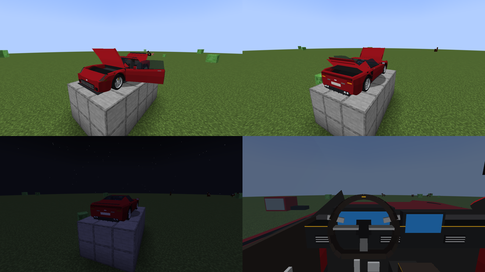
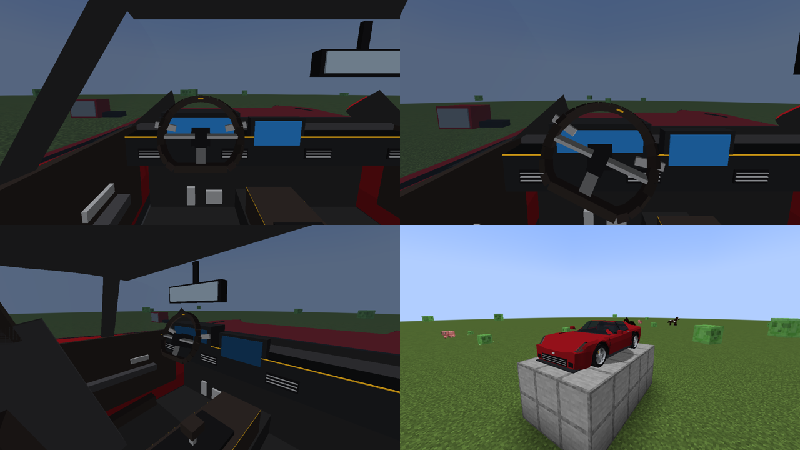
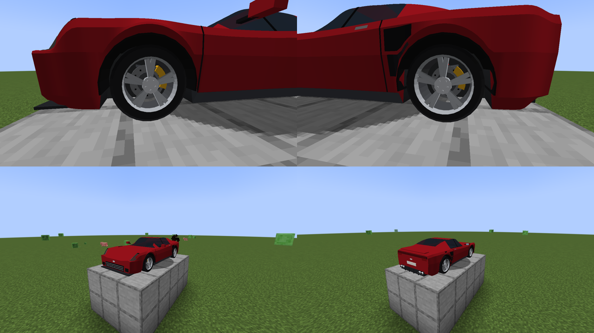
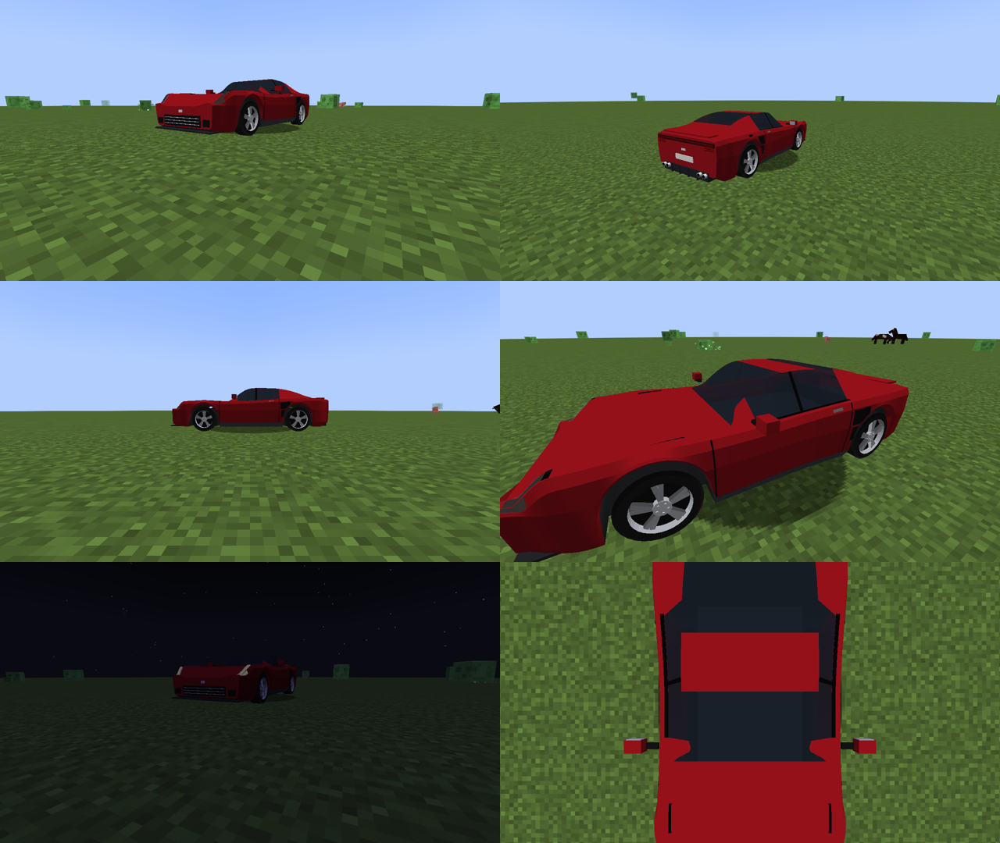
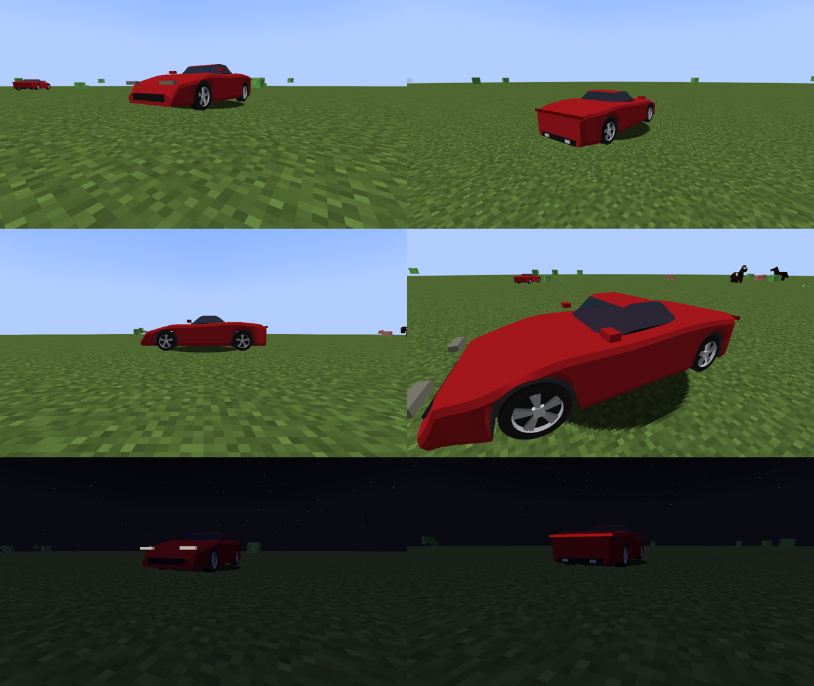

# VELOCITY — Patch Notes

Downloads: pasta [`releases/`](releases/). Instale o jar em `.minecraft/mods` junto com o
**Fabric Loader ≥ 0.16** e a **Fabric API** para **Minecraft 1.21.1**.

---

## Velo 0.07 — Áudio automotivo
**Jar:** `releases/Velocity-Velo-0.07-MC1.21.1.jar` · Minecraft 1.21.1 · Fabric API 0.116.18

🔊 **Ouça:** [`docs/audio/velo-0.07-gravacao-no-jogo.ogg`](docs/audio/velo-0.07-gravacao-no-jogo.ogg) —
gravação real de dentro do jogo: partida → aceleração com trocas de marcha → soltar o acelerador →
frenagem forte → buzina → desligar.

### Novidades
- **Motor V6 com som próprio em camadas:** 4 faixas de RPM (850 / 2.500 / 4.500 / 7.000) ×
  acelerando/desacelerando = 7 loops misturados em tempo real pelo RPM e pela carga do motor.
  A afinação acompanha o RPM; ao soltar o acelerador entra o som abafado de desaceleração.
- **Partida e desligamento:** motor de arranque girando até o motor "pegar" (~1,3 s); as camadas
  só entram depois da partida.
- **Sons novos:** buzina de 2 tons, portas (abrir/fechar com trinco), capô/tampa, troca de marcha,
  relé da seta (tic-tac, só para quem está dentro), **pneus cantando** (arrancada patinando,
  frenagem forte, curva no limite, freio de mão) e **vento** em alta velocidade (dentro do carro).
- Som de dentro do carro levemente abafado.
- Legendas (subtitles) em português e inglês para todos os sons.
- Física: o simulador agora calcula **carga do motor** e **patinação dos pneus** (usados pelo áudio
  e, no futuro, por marcas de pneu e desgaste).

### Como os sons foram feitos
- **100 % sintetizados por código** (`art/tools/gen_sounds.py`): o ronco é gerado a partir da física
  do V6 (3 explosões por volta, bancadas com escapes diferentes). Nenhuma gravação de terceiros →
  sem problema de licença. Total: 165 KiB.

### Testado
- **Gravação de áudio dentro do jogo** (OpenAL gravando a mixagem num arquivo) com o motorista
  apertando as teclas de verdade. Análise de frequência: marcha lenta em 43 Hz (= 850 rpm), tom
  subindo na aceleração, **queda na troca 1ª→2ª na razão 0,74 (física: 0,75)**, tom estável na
  desaceleração (= 6.050 rpm) e buzina em 410 Hz no momento certo.
- Loops sem salto na emenda (verificado numericamente).

### Limitações conhecidas
- **Eu não consigo ouvir:** a qualidade sonora foi verificada só por medição. Ouça a gravação e
  diga o que achou — dá para ajustar timbre, volume e mixagem.
- Um único perfil de motor (V6); outros motores virão com novos veículos.
- Som de batida ainda é o do Minecraft (Velo 0.08). Sem efeito Doppler.
- Até 4 veículos com som ao mesmo tempo (os mais próximos), para não esgotar os canais de áudio.

---

## Velo 0.06 — Portas, capô, porta-malas e sinalização
**Jar:** `releases/Velocity-Velo-0.06-MC1.21.1.jar` · Minecraft 1.21.1 · Fabric API 0.116.18

### Novidades
- **Portas abrem de verdade** (62°, dobradiça na frente): a porta leva junto vidro, retrovisor,
  maçaneta e forro interno.
- **Entrar pela porta:** clique na porta fechada → ela abre; clique na porta aberta → você senta
  **naquele lado** (esquerda = motorista, direita = passageiro) e a porta fecha sozinha.
  **Shift + clique** na porta aberta fecha sem entrar. Ao sair, a porta do seu lado abre e fecha.
- **Capô** (abre 55° na base do para-brisa) e **tampa traseira** (48°) — clique em cima deles.
- **Spoiler ativo:** sobe acima de 90 km/h e recolhe abaixo de 65 km/h.
- **Setas** (`,` e `.`) com repetidoras laterais e **pisca-alerta** (`K`), piscando em fase para
  todos os jogadores; a seta se desliga sozinha quando o volante volta ao centro após a curva.
  Indicadores ◀ ▶ na HUD.
- **Luzes de ré** acendem com a ré engatada.
- Você sai do carro pelo lado do seu assento, ao lado da porta.
- **Mira no veículo inteiro:** dá para mirar e clicar em qualquer ponto do carro (4,4 m),
  não só na caixa quadrada de 1,9 m do Minecraft.

### Para quem cria veículos
- `interaction_zones` no JSON do veículo: regiões clicáveis (porta/assento, capô, porta-malas).
  Esta é a base do sistema de interação com peças da oficina (Velo 0.13+).
- Novas fontes de animação: `door_l`, `door_r`, `hood`, `trunk`, `spoiler`; novos canais de luz:
  `turn_l`, `turn_r`, `reverse`.

### Correções
- Assentos fixos: quem entra pela porta direita vira passageiro, não motorista.
- Parar o veículo ao reposicioná-lo (`halt()`): antes ele continuava andando com a velocidade antiga.

### Testado
- Teste visual: porta, capô e tampa abrindo por cliques nas zonas; mira acertando a ponta do
  capô (z = 2,26 m, fora da caixa de colisão); pisca-alerta alternando entre quadros; luz de ré.

### Limitações conhecidas
- Sons de porta/capô são do Minecraft (ferro/baú) até a Velo 0.07.
- Cofre do motor ainda vazio sob o capô (o motor 3D vem com a mecânica de motor).
- A caixa de **colisão** com blocos continua 1,9 m × 1,9 m (a frente e a traseira podem entrar
  em paredes) — colisão orientada na Velo 0.08.
- O servidor só aceita cliques a até ~4 m da caixa de colisão; em carros longos, aproxime-se.

---

## Velo 0.05 — Interior completo e câmera interna
**Jar:** `releases/Velocity-Velo-0.05-MC1.21.1.jar` · Minecraft 1.21.1 · Fabric API 0.116.18

### Novidades
- **Interior do Aurion VX:** painel em plástico macio com faixa de alcântara e costura amarela,
  capuz do quadro de instrumentos com **tela digital**, **central multimídia**, 4 saídas de ar
  com aletas de alumínio, console central alto com seletor de câmbio curto, **bancos concha**
  (almofada, encosto, abas laterais, apoio de cabeça integrado, trilhos), forros de porta com
  apoio de braço e puxador, pedais de alumínio, carpete, retrovisor interno e forro de teto.
- **Volante animado** (base reta, 3 raios, aro em couro, aletas de troca): gira com o esterço
  numa relação de 12:1, em torno do eixo inclinado da coluna de direção.
- **Telas acendem quando o motor está ligado** (novo canal de luz "engine").
- **Câmera interna:** em primeira pessoa, o olho fica na altura de um motorista sentado (1,05 m),
  no banco da esquerda — dá para dirigir olhando pelo para-brisa, com painel e volante à frente.
- **Ocupantes em escala:** o jogador sentado é desenhado em 80 % do tamanho para caber sob o
  teto em escala real (o boneco do Minecraft tem cabeça muito grande).
- Vidros mais transparentes para o interior aparecer por fora.
- Modelos: animações agora aceitam **eixo e fator** configuráveis no JSON (`axis`, `factor`).

### Testado
- Teste visual: vista do interior, ponto de vista do motorista, volante esterçado à direita
  (gira no sentido horário), jogador sentado em 1ª pessoa (câmera no banco, abaixo do teto) e
  em 3ª pessoa (cabeça dentro da cabine).

### Limitações conhecidas
- As telas ainda não mostram velocidade/RPM (painel funcional na Velo 0.09, junto da HUD).
- Portas não abrem (Velo 0.06); entrar/sair ainda é clique direito / Shift.
- Jogadores aparecem 20 % menores só dentro do veículo — escolha visual consciente.
- Os mixins de câmera/escala só existem no cliente; servidores não são afetados.

---

## Velo 0.04 — Freios, suspensão e caixas de roda
**Jar:** `releases/Velocity-Velo-0.04-MC1.21.1.jar` · Minecraft 1.21.1 · Fabric API 0.116.18

### Novidades
- **Freios visíveis através das rodas:** discos ventilados (dianteiros 360 mm, traseiros 340 mm)
  com furos de ventilação e chapéu central; **pinças amarelas** de 2 corpos com ponte.
- **Pastilhas de freio como peças separadas** (2 por roda: interna e externa, com placa e
  material de atrito) — base para a troca de pastilhas da Velo 0.15.
- **Hierarquia mecânica correta:** discos giram com a roda; pinças, pastilhas e mangas de eixo
  ficam paradas mas acompanham o esterço das rodas dianteiras.
- **Suspensão duplo A visível:** braços superior e inferior, manga de eixo, cubo com rolamento,
  amortecedor e mola helicoidal vermelha em cada roda.
- **Para-barros** pretos dentro das caixas de roda (não se vê mais o "oco" da carroceria).
- Aro com barril interno: dá para ver o freio entre os raios sem ver o interior do pneu.
- O modelo agora tem **37 partes** (~11.500 triângulos).

### Ferramentas de desenvolvimento
- Teste visual: carro sobre plataforma, câmera em modo espectador (sem gravidade), closes
  de freio dianteiro e traseiro.

### Testado
- Teste visual dentro do jogo: closes das rodas mostram disco, furos e pinça na posição correta
  (atrás do eixo); carroceria e luzes inalteradas.

### Limitações conhecidas
- A suspensão é visual: ainda não comprime (física de suspensão na Velo 0.08).
- Parte de baixo ainda sem cárter, escapamento e câmbio modelados.
- Ainda sem interior (Velo 0.05).

---

## Velo 0.03 — Aurion VX: carroceria definitiva
**Jar:** `releases/Velocity-Velo-0.03-MC1.21.1.jar` · Minecraft 1.21.1 · Fabric API 0.116.18

### Novidades
- **O Aurion VX deixa de ser protótipo**: carroceria nova (~7.000 triângulos) feita como uma
  superfície contínua, com capô longo, cabine recuada e traseira fastback.
- **Para-lamas musculosos:** dianteiros com pico acima da roda, "ombros" traseiros mais largos
  e cintura afinada nas portas.
- **Frente:** faróis em "L" com luz diurna (DRL) sempre acesa, grade trapezoidal com 3 frisos
  cromados, entradas de ar laterais, splitter em carbono e emblema.
- **Lateral:** frisos das portas, maçaneta cromada, entrada de ar atrás da porta (intercooler),
  saia lateral em carbono, moldura preta das janelas e coluna B escurecida.
- **Teto:** para-brisa e vidro traseiro inclinados, janelas laterais entre as colunas A e C.
- **Traseira:** lanterna contínua com assinatura de 3 barras em cada lado, difusor em carbono
  com 4 aletas, 4 saídas de escape tubulares, placa, emblema e spoiler (parte separada, pronta
  para virar spoiler ativo na Velo 0.06).
- Saídas de ar no capô, bocal de combustível e retrovisores com haste, carcaça e espelho.
- **Rodas novas:** dianteiras 19" (pneu 245) e traseiras 20" (pneu 285), 5 raios duplos,
  cubo central e 5 porcas por roda.
- Novo material: carbono, espelho, placa e DRL.
- `art/tools/meshlib.py`: biblioteca de geometria reutilizável para os próximos veículos.

### Mudanças
- O item agora se chama **Aurion VX** (`velocity:aurion_vx`). Veículos já colocados no mundo
  nas versões 0.01/0.02 são convertidos automaticamente. **Itens antigos do inventário
  (Aurion VX Protótipo) somem** — pegue um novo na aba Ferramentas.

### Testado
- Teste visual dentro do jogo em 9 ângulos, de dia e de noite (imagem acima).
- Teste automático: esterçar à direita vira o carro para a direita; 9 testes da física passam.

### Limitações conhecidas
- Ainda **sem interior** (cabine escura por trás dos vidros) — Velo 0.05.
- Sem discos e pinças de freio atrás das rodas — Velo 0.04.
- Parte de baixo ainda é um assoalho simples (o detalhamento vem com a mecânica).
- Cores sólidas por material, sem texturas finas (pintura metálica, carbono trançado) ainda.
- O veículo não atende ainda aos critérios de "visualmente completo" (docs/ARCHITECTURE.md §F):
  faltam interior (item 6), freios visíveis (5), parte inferior (9).

---

## Velo 0.02 — Modelos 3D de verdade
**Jar:** `releases/Velocity-Velo-0.02-MC1.21.1.jar` · Minecraft 1.21.1 · Fabric API 0.116.18

### Novidades
- **Carregador de malhas 3D (OBJ):** veículos agora são desenhados com polígonos de verdade,
  não com cubos. Isso libera carrocerias curvas, rodas com raios, interiores etc.
- Partes com **pivôs e hierarquia** definidos em JSON (`assets/<mod>/vehicle_models/<id>.json`):
  rodas giram em torno do próprio eixo e as dianteiras esterçam em torno do pivô de direção.
- **Materiais por papel:** pintura (cor aplicada em tempo real — base para a pintura customizada),
  vidro translúcido, emissivo (faróis e lanternas acendem) e opaco.
- **Novo visual do protótipo Aurion VX** (~4.000 triângulos): carroceria esculpida por seções,
  caixas de roda recortadas, cabine com para-brisa inclinado, rodas com 5 raios duplos,
  pneus com banda e ombro, retrovisores, grade, difusor e 2 saídas de escape.
- Recarregar resource packs (**F3+T**) recarrega os modelos; um modelo com erro aparece no log
  e o veículo usa o modelo antigo de cubos em vez de sumir.

### Correções
- Luz de freio não acendia ao pisar no freio com o carro parado e motor desligado
  (o carro engatava ré). Agora a ré só engata com o motor ligado.

### Testado
- 9 testes automáticos da física passam.
- **Primeiro teste visual dentro do jogo:** o Minecraft foi aberto (renderização por software),
  o carro foi colocado num mundo e fotografado de 9 ângulos, de dia e de noite.
  Confirmado: modelo aparece, rodas no lugar, faróis e luz de freio acendem,
  e esterçar para a direita vira o carro para a direita.

### Limitações conhecidas
- Ainda é um **protótipo**: o desenho definitivo do Aurion VX vem na Velo 0.03.
- Sem interior (a cabine é fechada) e sem discos/pinças de freio visíveis (Velo 0.04/0.05).
- Cores sólidas por material, sem texturas detalhadas ainda.
- Sons temporários; atraso de controle em servidores; sem suspensão (inalterados).

---

## Velo 0.01 — Fundação
**Jar:** `releases/Velocity-Velo-0.01-MC1.21.1.jar` · Minecraft 1.21.1 · Fabric API 0.116.18

### Novidades
- Primeiro veículo dirigível: **Aurion VX (Protótipo)**, na aba *Ferramentas* do criativo.
- Física simulada no servidor: curva de torque do motor, 6 marchas com câmbio automático,
  arrasto aerodinâmico, resistência ao rolamento, freio, freio-motor e freio de mão.
- Aderência por superfície: asfalto/pedra, grama, cascalho, areia, lama, neve e gelo.
- Ré automática: com o carro parado, segure **S**.
- Combustível com consumo proporcional à potência; o motor desliga quando o tanque esvazia.
- Faróis (**J**) e luz de freio acendem com brilho total, mesmo à noite.
- Buzina (**H**) e ligar/desligar motor (**N**). Teclas remapeáveis em *Controles → VELOCITY*.
- HUD: velocidade em km/h, marcha, barra de RPM, combustível e estado do motor.
- Batidas reduzem a integridade do veículo. **Shift + ataque** recolhe o veículo como item.
- Veículos definidos por arquivos JSON (data pack), sem precisar de código novo.

### Testado
- Compila; 8 testes automáticos da física passam (0–100 km/h em 3,4 s).
- Servidor dedicado inicia e carrega a definição do veículo.

### Não testado / limitações conhecidas
- **Não testado com o jogo aberto** (o ambiente de build não tem placa de vídeo).
- O visual é um **modelo provisório feito de cubos**, não o carro final.
- Sons de motor/buzina são sons do Minecraft temporários.
- O sentido em que as rodas dianteiras viram pode estar invertido.
- ~1 ping de atraso nos controles em servidores (o servidor decide o movimento).
- Sem suspensão nem inclinação em rampas; sobe degraus de até 0,6 bloco.
- Velocidade máxima (~319 km/h) está alta para este motor; recalibração na Velo 0.08.
- A lista de mods do Fabric mostra a versão como "0.1" (o nome do mod mostra "Velo 0.01").
