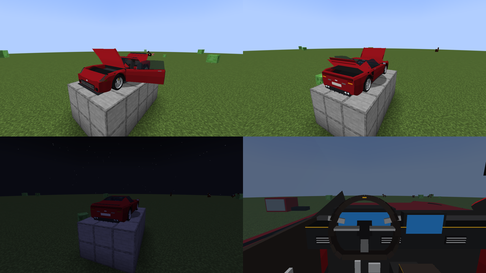

# VELOCITY — Ultimate Vehicle Mod

Mod de veículos para **Minecraft Java 1.21.1 / Fabric / Java 21**. Versão atual: **Velo 0.06**.



- **Download:** pasta [`releases/`](releases/) (um jar por versão, com a versão do jogo no nome)
- **Novidades:** [`PATCH_NOTES.md`](PATCH_NOTES.md)
- **Próximas versões:** [`ROADMAP.md`](ROADMAP.md)
Arquitetura, pipeline de assets e critérios de qualidade: [`docs/ARCHITECTURE.md`](docs/ARCHITECTURE.md).

## Compilar
```bash
./gradlew build          # jar em build/libs/
./gradlew test           # testes da física
./gradlew runClient      # abre o Minecraft de desenvolvimento
./gradlew release        # gera releases/Velocity-Velo-<versão>-MC<jogo>.jar
art/tools/visual_test.sh # abre o jogo sem monitor e tira screenshots do veículo (build/visualtest/)
```

## Testar no jogo
1. `./gradlew runClient`, crie um mundo em modo criativo.
2. Na aba **Ferramentas**, pegue **Aurion VX** e clique com o botão direito no chão.
3. Clique na **porta** para abri-la e clique de novo para sentar (porta esquerda = motorista).
   Clique no **capô** ou na **tampa traseira** para abri-los. **N** liga o motor.
4. **W** acelera, **S** freia (parado: ré), **A/D** esterça, **Espaço** freio de mão, **J** faróis, **H** buzina,
   **,** / **.** setas, **K** pisca-alerta.
5. **Shift** sai. **Shift + clique** na porta aberta fecha. **Shift + ataque** recolhe o veículo.
6. Teste aderência: dirija sobre gelo, areia e grama.

> ⚠️ O modelo visual atual é um **protótipo de cubos para validar pivôs e animação**, não o asset final.
> Veja a tabela de status no fim do documento de arquitetura.
